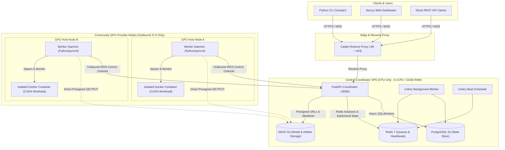

# Decentralized AI Compute Cloud Platform

A functional, secure, production-grade MVP for a decentralized community GPU AI compute cloud platform. The platform coordinates third-party compute providers to execute AI inference (LLMs, Diffusion) and distributed fine-tuning (LoRA, federated averaging) under strict isolation and zero-trust security boundaries.

---

## 1. Architectural Highlights

- **Central Coordinator (CPU-Only):** Orchestrates scheduling, authentication, worker state machines, telemetry, and artifact management on an 8 vCPU / 32 GB RAM Linux host without loading large model weights into memory.
- **Outbound Worker Daemon:** Independent GPU hosts connect outbound via WebSocket over TLS (`wss://`) with no public IP or open inbound firewall ports required.
- **Docker-Isolated Workloads:** Workloads run inside constrained, non-privileged Docker containers leveraging the NVIDIA Container Toolkit with strictly defined CPU, RAM, and VRAM limits.
- **Direct-to-Storage Artifact Flow:** Models, datasets, and checkpoints stream directly between MinIO (S3-compatible) and workers using short-lived cryptographically signed URLs.
- **Metering & Settlement Audit:** Every GPU second and VRAM allocation is metered and stored in immutable database audit records.

---

## 2. Infrastructure Architecture



---

## 3. Repository Structure

```text
decentralized-ai-cloud/
├── coordinator/
│   ├── main.py               # FastAPI application entrypoint & lifecycle
│   ├── config.py             # Pydantic Settings configuration
│   ├── database.py           # Async SQLAlchemy 2.0 engine & session dependency
│   ├── storage.py            # MinIO S3 object storage manager
│   ├── redis_client.py       # Async Redis connection pool & health probe
│   ├── api/
│   │   ├── __init__.py
│   │   └── health.py         # /health, /health/live, /health/ready probes
│   ├── models/               # SQLAlchemy 2.0 ORM domain models
│   │   ├── __init__.py       # Centralized Base.metadata registration
│   │   ├── base.py           # UUID & Timestamp mixins
│   │   ├── user.py           # User & APIKey models
│   │   ├── worker.py         # Worker, GPUDevice, WorkerHeartbeat models
│   │   ├── job.py            # Job, JobAttempt, JobEvent state machine
│   │   ├── artifact.py       # ModelManifest, ModelVersion, Dataset, Artifact
│   │   ├── training.py       # TrainingRound & WorkerContribution
│   │   └── usage.py          # Metering & UsageRecord
│   └── tasks/
│       ├── __init__.py
│       └── celery_app.py     # Celery background tasks & schedules
├── shared/
│   ├── __init__.py
│   ├── constants.py          # Domain enums & WebSocket message types
│   ├── schemas.py            # Shared Pydantic data schemas
│   └── protocol.py           # Typed WebSocket messaging envelopes
├── deployment/
│   ├── Dockerfile.coordinator# Multi-stage production container build
│   ├── Dockerfile.worker     # CUDA worker container image
│   ├── Caddyfile             # Edge reverse proxy configuration
│   ├── install.sh            # Worker installation bash script
│   └── backup.sh             # Automated backup utility
├── migrations/
│   ├── env.py                # Alembic async migration runner
│   ├── script.py.mako        # Migration template
│   └── versions/
│       └── 0001_initial_schema.py # Complete baseline database schema
├── tests/
│   ├── unit/
│   │   ├── test_health.py    # Health & protocol unit tests
│   │   └── test_models.py    # Database models & relationships tests
├── docker-compose.yml        # Production-grade 8-core VPS compose stack
├── pyproject.toml            # Dependencies and tool configurations
├── .env.example              # Full environment variable specification
├── Makefile                  # Developer and deployment CLI targets
└── README.md                 # System documentation
```

---

## 4. Quickstart: Launching the Stack

### Step 1: Clone and Configure Environment

```bash
git clone https://github.com/your-org/decentralized-ai-cloud.git
cd decentralized-ai-cloud

# Copy environment template
cp .env.example .env
```

Review `.env` and configure passwords and secrets for production.

### Step 2: Launch Infrastructure with Docker Compose

```bash
docker compose up -d --build
```

This starts:
- `PostgreSQL 16` on internal port 5432
- `Redis 7` on internal port 6379
- `MinIO S3` on internal port 9000 (dashboard on 9001)
- `FastAPI Coordinator` on internal port 8000
- `Celery Worker & Beat` for asynchronous background jobs
- `Caddy Reverse Proxy` on port 80/443

### Step 3: Run Database Migrations

Apply the initial schema using Alembic:

```bash
# Inside coordinator container:
docker compose exec coordinator alembic upgrade head

# Or from host if virtual environment is active:
make migrate
```

### Step 4: Verify Health Probes

Verify the service is up and healthy:

```bash
# 1. Liveness Probe (immediate process check)
curl -i http://localhost:8000/health/live

# 2. Readiness Probe (verifies Postgres, Redis, and MinIO connectivity)
curl -i http://localhost:8000/health/ready

# 3. Detailed Subsystem Status
curl -i http://localhost:8000/health
```

Expected output for `/health`:
```json
{
  "status": "healthy",
  "service": "decentralized-ai-cloud-coordinator",
  "environment": "development",
  "subsystems": {
    "postgresql": { "status": "healthy", "connected": true, "latency_ms": 1.25 },
    "redis": { "status": "healthy", "connected": true, "latency_ms": 0.85 },
    "minio": { "status": "healthy", "connected": true, "latency_ms": 3.12 }
  }
}
```

---

## 5. Development & Testing

```bash
# Install local dependencies in editable mode
make install

# Run unit tests
make test

# Run code style & linting checks with Ruff
make lint

# Auto-format codebase
make format
```

---

## 6. Threat Model & Security Boundaries

1. **Untrusted Worker Nodes:**
   - Workers never receive cluster admin credentials or database access.
   - Workers are authenticated using HMAC token hashes and per-worker secrets.
   - Workers communicate strictly over outbound WebSockets.
   - Artifact transfers utilize short-lived (e.g. 1 hour) pre-signed URLs with SHA-256 checksum verification.

2. **Workload Sandboxing:**
   - Workloads execute in non-privileged Docker containers.
   - Host filesystem and host Docker socket mounting (`/var/run/docker.sock`) are strictly prohibited.
   - Direct execution of arbitrary Python scripts on the host is disallowed.

3. **Coordinator Protection:**
   - The coordinator never loads heavy model tensors into RAM.
   - All models, datasets, and weights are processed in streaming chunks and inspected by metadata only.

