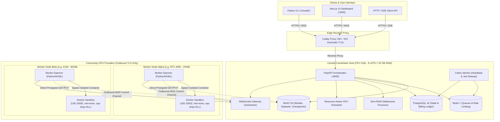

# Decentralized AI Compute Cloud Platform

[](https://python.org)
[](https://fastapi.tiangolo.com)
[](https://developer.nvidia.com/cuda-zone)
[](https://docker.com)
[](https://nextjs.org)
[](LICENSE)

A functional, secure, production-grade platform for a decentralized, community-powered GPU AI compute marketplace. The platform enables users to submit AI inference (LLMs, Diffusion) and distributed fine-tuning (LoRA, Federated Averaging) jobs executed across untrusted, third-party GPU compute providers under strict hardware isolation, zero-RAM coordinator routing, and billing-ready audit metering.

---

## 1. Executive Summary & Core Architectural Invariants

### Fundamental Invariants

1. **CPU-Only Central Coordinator VPS (8 vCPU / 32 GB RAM / 1 TB NVMe SSD):**
   - The coordinator never performs local GPU inference or training.
   - **Zero-RAM Model Inspection:** The coordinator never loads multi-gigabyte model weights into memory. It unpacks only the 8-byte little-endian header length of Safetensors files to parse tensor metadata and validate layer topology.
2. **Outbound-Only Community Worker Nodes:**
   - Independent compute nodes connect outbound via WebSocket over TLS (`wss://`).
   - No public IP addresses, domain names, or open inbound firewall ports are ever required for worker nodes.
3. **Zero-Trust Workload Isolation:**
   - Every community node is treated as potentially untrusted; every user payload is treated as adversarial.
   - Workloads execute inside non-privileged Docker containers (`user="10002:10002"`, `network_mode="none"`, `cap_drop=["ALL"]`, `security_opt=["no-new-privileges:true"]`, memory and CPU quotas).
4. **Direct-to-Storage Artifact Streaming:**
   - Model weights, training datasets, and checkpoints transfer directly between MinIO (S3-compatible) and worker nodes using short-lived cryptographically signed URLs with SHA-256 integrity verification.
5. **Mathematically Sound LoRA Federated Averaging (FedAvg):**
   - The coordinator enforces strict topology invariants (identical base models, rank $r$, $\alpha$ scaling factors, and matching target module sets) before calculating sample-weighted weight aggregations. Incompatible checkpoints are rejected.

---

## 2. Platform Architecture



---

## 3. Technology Stack

| Component | Technology | Role & Justification |
| :--- | :--- | :--- |
| **Coordinator API** | FastAPI / Uvicorn | High-performance asynchronous REST & WebSocket framework |
| **Relational Store** | PostgreSQL 16 + SQLAlchemy 2.x | ACID state machine, job attempts, billing-ready audit records |
| **Cache & Queues** | Redis 7 + Celery 5.x | Ephemeral worker telemetry, scheduling queues, task leases |
| **Object Storage** | MinIO (S3-Compatible) | Direct-to-storage artifact streaming with signed URLs |
| **Authentication** | Argon2id + JWT + HMAC | RFC 9106 password hashing, tokenized auth, and worker verification |
| **Worker Telemetry** | NVML (`pynvml`) + `psutil` | Real-time GPU VRAM, utilization, temperature, power, clock rates |
| **Container Sandbox** | Docker Engine + NVIDIA Toolkit | Isolated non-root environments with dropped capabilities |
| **AI Inference** | Hugging Face Transformers + Diffusers | LLM text generation and Stable Diffusion pipeline execution |
| **Distributed AI** | PEFT (LoRA) + PyTorch + FedAvg | Parameter-efficient fine-tuning with verified weight aggregation |
| **Developer CLI** | Typer + Rich + HTTPX | Ergonomic command-line management client (`cloudai`) |
| **Web Dashboard** | Next.js 14 + React + Tailwind CSS | Real-time GPU marketplace, inference sandbox, and job metrics |

---

## 4. Repository Structure

```text
gooys/
├── coordinator/               # Central Orchestrator & API Service
│   ├── api/                  # REST API endpoints (auth, workers, jobs, artifacts, health)
│   ├── auth/                 # Argon2id hashing, JWT, API keys, role-based authorization
│   ├── models/               # SQLAlchemy 2.0 ORM schemas (15 relational tables)
│   ├── schemas/              # Pydantic v2 validation models
│   ├── websocket/            # Worker WebSocket connection manager & message router
│   ├── scheduler.py          # Resource-aware GPU scoring & allocation engine
│   ├── model_processor.py    # Zero-RAM Safetensors inspection & LoRA FedAvg math
│   ├── task_dispatcher.py    # Job queueing, lease assignment, and worker dispatch
│   ├── database.py           # Async engine and session factory
│   ├── storage.py            # MinIO S3 signed URL generator & bucket manager
│   ├── redis_client.py       # Redis pool and heartbeat tracker
│   └── main.py               # Application entrypoint & middleware assembly
├── worker/                   # Community GPU Worker Daemon
│   ├── workloads/            # Sandboxed workload runners (inference, LoRA, FedAvg)
│   ├── agent.py              # Outbound WebSocket client & state machine
│   ├── docker_runtime.py     # Container isolation (cap-drop, net=none, non-root)
│   ├── executor.py           # Task coordinator, artifact staging, and log streaming
│   ├── gpu_monitor.py        # NVML interrogation with simulation fallback
│   ├── artifact_client.py    # Chunked S3 streaming with SHA-256 verification
│   ├── heartbeat.py          # Periodic telemetry sync daemon
│   └── config.py             # Worker daemon configuration settings
├── shared/                   # Shared Schemas & Protocol Envelopes
│   ├── constants.py          # Enums (JobStatus, WorkerStatus, UserRole, etc.)
│   ├── protocol.py           # Typed WebSocket message envelopes
│   └── schemas.py            # Common data transfer objects
├── cli/                      # Developer & Operator Command Line Interface
│   ├── commands/             # CLI subcommands (auth, workers, models, datasets, jobs)
│   ├── client.py             # HTTPX authenticated API client
│   └── main.py               # Typer entrypoint ('cloudai')
├── dashboard/                # Next.js 14 Web Frontend
│   ├── app/                  # App router pages (overview, marketplace, inference, training, jobs)
│   └── lib/api.ts            # Client API bindings
├── deployment/               # Production Packaging & Operations
│   ├── Dockerfile.coordinator# Multi-stage coordinator build
│   ├── Dockerfile.worker     # CUDA worker container image
│   ├── Caddyfile             # Edge reverse proxy configuration
│   ├── install.sh            # Worker auto-install script
│   ├── backup.sh             # PostgreSQL & MinIO automated backup script
│   └── restore.sh            # Disaster recovery restoration utility
├── migrations/               # Alembic database migrations
├── scripts/                  # Automated verification & testing utilities
│   └── verify_deployment.py  # Full 7-stage end-to-end deployment verification
├── docs/                     # Production Runbooks & Security Architecture
│   ├── SECURITY_AUDIT_AND_SANDBOXING.md
│   ├── WORKER_ONBOARDING_RUNBOOK.md
│   └── COORDINATOR_OPERATIONS_AND_BACKUP.md
├── docker-compose.yml        # Production stack for 8-core VPS
└── pyproject.toml            # Project metadata and pinned dependencies
```

---

## 5. Quickstart & Deployment

### Step 1: Launch Infrastructure Stack

```bash
# Clone the repository
git clone https://github.com/liladhiee-web/Decentralized.git
cd Decentralized

# Set up environment variables
cp .env.example .env
# Configure secure passwords and secrets in .env

# Launch Coordinator stack
docker compose up -d --build
```

### Step 2: Run Database Migrations

```bash
docker compose exec coordinator alembic upgrade head
```

### Step 3: Verify Subsystem Health Probes

```bash
# Liveness Probe (process responsiveness)
curl -i http://localhost:8000/health/live

# Readiness Probe (PostgreSQL, Redis, MinIO connectivity)
curl -i http://localhost:8000/health/ready

# Deep Subsystem Diagnostics
curl -i http://localhost:8000/health
```

---

## 6. Community Worker Onboarding

Community GPU providers can join the network in minutes using the automated installation workflow:

```bash
# 1. Obtain registration token via CLI
cloudai workers register --name "node-rtx4090-01"

# 2. Run installer on the GPU host
curl -fsSL https://coordinator.domain.com/install.sh | sudo bash -s -- \
  --token "cld_wrk_your_worker_secret_token" \
  --coordinator "https://coordinator.domain.com"
```

The installer verifies NVIDIA drivers (`nvidia-smi`), configures the NVIDIA Container Toolkit runtime in `/etc/docker/daemon.json`, sets up an isolated Python virtual environment, installs the systemd unit (`cloudai-worker.service`), and starts the background daemon.

Inspect live telemetry logs:
```bash
journalctl -u cloudai-worker -f
```

For complete manual setup instructions and troubleshooting, see [Worker Onboarding Runbook](docs/WORKER_ONBOARDING_RUNBOOK.md).

---

## 7. Developer CLI (`cloudai`) Usage

The platform includes a CLI built with Typer and Rich:

```bash
# Authentication
cloudai auth login --email researcher@example.com
cloudai auth api-key-create --name "ci-pipeline-key"

# Worker Management
cloudai workers list
cloudai workers register --name "lab-workstation-01"

# Model Catalog
cloudai models list
cloudai models create --name "meta-llama/Meta-Llama-3-8B-Instruct" --architecture "LlamaForCausalLM"

# Submit AI Inference Job
cloudai inference text \
  --model "meta-llama/Meta-Llama-3-8B-Instruct" \
  --prompt "What are the primary synchronization trade-offs in distributed LoRA?" \
  --max-tokens 256

# Submit LoRA Fine-Tuning Job
cloudai training lora \
  --model "meta-llama/Meta-Llama-3-8B" \
  --dataset-id "3fa85f64-5717-4562-b3fc-2c963f66afa6" \
  --rank 16 \
  --alpha 32 \
  --epochs 3

# Monitor Jobs & Stream Logs
cloudai jobs list
cloudai jobs get <JOB_ID>
cloudai jobs stream <JOB_ID>
```

---

## 8. Web Dashboard (Next.js 14)

A reactive dashboard for GPU marketplace visibility, model catalog exploration, interactive inference testing, and live training monitoring:

```bash
cd dashboard
npm install
npm run dev
```

Visit `http://localhost:3000` to access:
- **GPU Marketplace:** Live grid of community compute nodes, total VRAM, utilization meters, and hourly spot pricing.
- **Inference Console:** Playground for prompt submission, token generation, and streaming output inspection.
- **LoRA Training Form:** Job configuration with validation of rank $r$, $\alpha$, epochs, and learning rates.
- **Job History:** Audit log of queued, executing, and completed jobs with real-time SSE progress updates.

---

## 9. Security Hardening & Threat Model

For the exhaustive security audit, container boundaries, and microVM migration roadmap, consult [Security Audit & Sandboxing Documentation](docs/SECURITY_AUDIT_AND_SANDBOXING.md).

### Workload Sandboxing Summary
- **Unprivileged Non-Root:** User namespace UID/GID `10002:10002`.
- **Dropped Capabilities:** `cap_drop=["ALL"]`.
- **Privilege Escalation:** `no-new-privileges:true`.
- **Zero Networking:** `network_mode="none"`. Workloads cannot access the internet or local network.
- **MicroVM Migration Path:** Production environments running hostile code can switch `DockerRuntime` to **Kata Containers 3.x** or **gVisor (`runsc`)** with hardware VFIO GPU passthrough for complete kernel-level isolation.

---

## 10. Verification & Operations

### Automated 7-Stage End-to-End Verification

Validate the full system lifecycle (health checks, authentication, worker registration, cataloging, job submission, scheduling, and FedAvg validation):

```bash
python scripts/verify_deployment.py
```

### Running Test Suite

```bash
# Run all unit and integration tests (25 passing test suites)
python -m pytest tests/ -v

# Run Ruff linter and code formatting validation
python -m ruff check .
python -m ruff format --check .
```

### Backup & Disaster Recovery

```bash
# Create an atomic backup (PostgreSQL dump + MinIO volume snapshot)
sudo bash deployment/backup.sh

# Restore from a backup archive
sudo bash deployment/restore.sh \
  /var/backups/cloudai/cloudai_postgres_YYYYMMDD_HHMMSS.dump.gz \
  /var/backups/cloudai/cloudai_minio_YYYYMMDD_HHMMSS.tar.gz
```

See [Coordinator Operations Runbook](docs/COORDINATOR_OPERATIONS_AND_BACKUP.md) for full operational runbooks.
