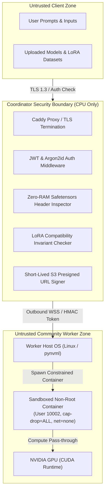

# Security Architecture, Audit & Workload Sandboxing

## 1. Zero-Trust Security Threat Model

In a decentralized, community-powered AI compute cloud, compute providers (workers) and model consumers (users) are untrusted third parties. The security model must operate under strict zero-trust assumptions:



### Threat Vectors & Mitigations

| Threat Vector | Potential Impact | CloudAI Platform Mitigation |
| :--- | :--- | :--- |
| **Malicious Worker Node** | Worker attempts to intercept user prompts or forge fine-tuned model checkpoints. | Workload inputs/outputs are transferred over TLS; model weights and outputs are signed with SHA-256 checksums. Worker contributions in federated learning are strictly validated against base model topology and rank invariants before aggregation. |
| **Malicious Workload (Escape)** | Untrusted model/script attempts to compromise community GPU host (filesystem read/write, crypto-mining, botnet lateral movement). | Workloads execute inside non-root Docker containers (`user="10002:10002"`), with `--cap-drop=ALL`, `network_mode="none"`, `security_opt=["no-new-privileges:true"]`, read-only inputs mount, and strict CPU/RAM quotas. |
| **Model Poisoning / Weight Corruption** | Adversarial fine-tuning node sends incompatible or poisoned weights into Federated LoRA rounds. | The Coordinator's `model_processor.py` enforces mathematical compatibility ($r$, $\alpha$, target modules, layer dimensions) and compute weighted FedAvg based on validated sample counts. Divergent gradients/ranks are rejected. |
| **Resource Exhaustion on Coordinator** | User uploads massive 70B+ parameter model; coordinator runs out of memory (OOM crash). | The coordinator is CPU-only and enforces **Zero-RAM inspection**: it reads only the 8-byte little-endian header length of Safetensors files to extract JSON tensor metadata. Model weights stream directly between MinIO and workers. |
| **Man-in-the-Middle (MITM) & Replay Attacks** | Eavesdropper intercepts task assignments or alters worker telemetry. | All communication operates over TLS 1.3 (`https://` and `wss://`). Worker authentication uses per-worker HMAC-SHA256 tokens and time-windowed heartbeats with sequential IDs. |

---

## 2. Workload Container Isolation Specification

The worker daemon (`worker/docker_runtime.py`) spawns untrusted execution containers with defense-in-depth isolation:

### Container Security Settings

1. **Unprivileged Non-Root Execution (`user="10002:10002"`):**
   Containers execute strictly under non-root UID/GID `10002:10002`. In the event of a container escape, the attacker has no root privileges on the host system.
2. **Total Linux Capability Stripping (`cap_drop=["ALL"]`):**
   All 41+ Linux capabilities (including `CAP_SYS_ADMIN`, `CAP_NET_RAW`, `CAP_DAC_OVERRIDE`, `CAP_SYS_PTRACE`) are dropped.
3. **Privilege Escalation Prevention (`security_opt=["no-new-privileges:true"]`):**
   Prevents processes inside the container from gaining additional privileges via `setuid` or `setgid` binaries.
4. **Network Isolation (`network_mode="none"`):**
   During execution, the workload container has loopback only and no external internet or local network access. All artifacts (weights, datasets) must be pre-fetched by the worker daemon before container launch. The container cannot exfiltrate data, join botnets, or phone home.
5. **Read-Only Input Volume Mounts:**
   The input directory `/workspace/inputs` is mounted with `:ro` (read-only). Workloads cannot tamper with cached base model weights or input datasets.
6. **Hardware Quotas & Cgroups v2:**
   - Memory limits enforced via `mem_limit` (e.g. `32768m`) to prevent host OOM kills.
   - CPU throttling enforced via `nano_cpus` (e.g. 4.0 cores).
   - Execution timeouts strictly kill runaway processes.

---

## 3. Sandboxing Evolution: Transition to MicroVMs (Kata Containers & gVisor)

While Linux cgroups and namespaces provide strong operational isolation, container engines share the host Linux kernel. In hostile multi-tenant environments with untrusted user-submitted code, kernel zero-days (e.g. dirty COW, CVE-2024-21626) pose escape risks.

### Sandboxing Architecture Comparison

```text
┌─────────────────────────────────┐   ┌─────────────────────────────────┐   ┌─────────────────────────────────┐
│     Standard Docker / OCI       │   │        gVisor (runsc)           │   │         Kata Containers         │
│  (Current Baseline for Tasks)   │   │     (User-space Kernel)         │   │      (MicroVM Isolation)        │
├─────────────────────────────────┤   ├─────────────────────────────────┤   ├─────────────────────────────────┤
│ [Untrusted Workload]            │   │ [Untrusted Workload]            │   │ [Untrusted Workload]            │
│ [Containers (cgroups/caps)]     │   │ [Sentry User-space Kernel]      │   │ [Guest OS & Guest Kernel]       │
├─────────────────────────────────┤   ├─────────────────────────────────┤   ├─────────────────────────────────┤
│ [Shared Host Linux Kernel]      │   │ [nvproxy (GPU intercept)]       │   │ [QEMU / Cloud-Hypervisor]       │
│ [NVIDIA Host Driver]            │   │ [Host Kernel & NVIDIA Driver]   │   │ [VFIO PCIe GPU Passthrough]     │
│ [Physical Hardware / GPU]       │   │ [Physical Hardware / GPU]       │   │ [Physical Hardware / GPU]       │
└─────────────────────────────────┘   └─────────────────────────────────┘   └─────────────────────────────────┘
```

### Migration Path to Kata Containers

For public cloud providers handling arbitrary arbitrary foreign code:
1. **Runtime Replacement:** Install Kata Containers 3.x with Cloud-Hypervisor or QEMU.
2. **GPU Passthrough:** Configure VFIO-PCI GPU passthrough in `/etc/kata-containers/configuration.toml`.
3. **Worker Runtime Configuration:** In `worker/docker_runtime.py`, specify `runtime="kata-qemu"`. Each workload runs in its own dedicated hardware-virtualized microVM with an independent Linux kernel. Cold-start overhead is ~400ms compared to standard Docker.

---

## 4. Zero-RAM Inspection & Weight Aggregation Invariants

### Zero-RAM Safetensors Header Parsing

The coordinator never buffers 10GB–100GB model weight files into RAM. The Safetensors format specifies that the first 8 bytes of the file are an unsigned 64-bit little-endian integer ($N$) representing the byte length of the JSON metadata header:

$$\text{Header Length} = \text{unpack}("<Q", \text{file}[0..8])$$

The coordinator reads exactly $8 + N$ bytes, parses the UTF-8 JSON header, and derives:
- Model architecture and tensor names
- Parameter count and data types (BF16, FP16, INT8, INT4)
- Tensor shapes and LoRA rank / alpha parameters

### LoRA Federated Averaging Invariants

When coordinating multi-node Federated LoRA training, the coordinator strictly verifies compatibility invariants before computing weighted FedAvg:

1. **Topology Invariant:** Both base model IDs must match exactly.
2. **Rank Invariant:** Adapter ranks $r_A == r_B$ must be identical across all workers.
3. **Alpha Invariant:** Scaling factors $\alpha_A == \alpha_B$ must match.
4. **Target Module Invariant:** Targeted layers (e.g. `q_proj`, `v_proj`) must be identical.
5. **Sample Weight Invariant:** Aggregation weights are normalized:
   $$w_i = \frac{n_i}{\sum_{k=1}^K n_k}, \quad \sum_{i=1}^K w_i = 1.0$$

Any adapter submission violating these mathematical invariants is rejected with HTTP 400 and logged to the audit trail.

